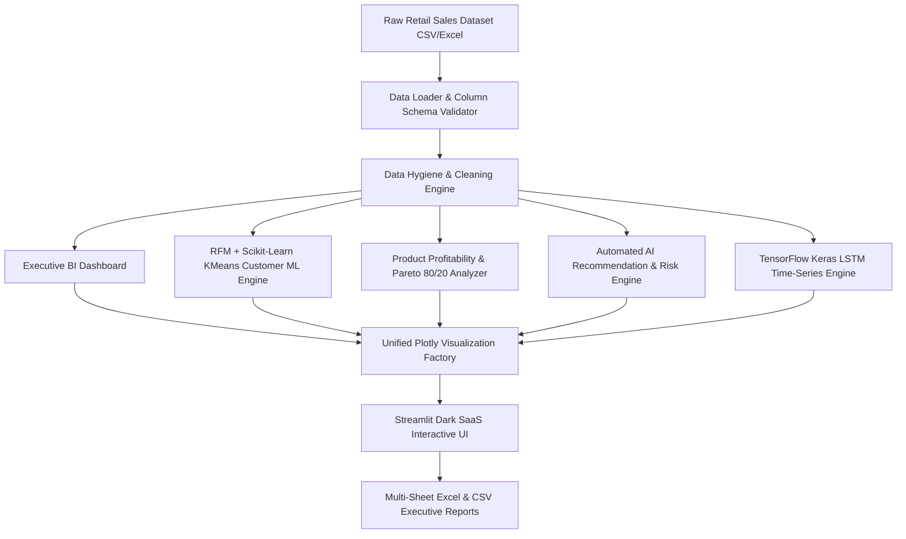

# ⚡ InsightAI – AI-Powered Business Intelligence Platform

[](https://www.python.org/)
[](https://streamlit.io/)
[](https://tensorflow.org/)
[](https://scikit-learn.org/)
[](https://plotly.com/)
[](https://www.docker.com/)
[](LICENSE)

**InsightAI** is an enterprise-grade, recruiter-ready AI Business Intelligence & Predictive Analytics Platform designed to help businesses analyze retail sales performance, visualize multi-dimensional trends, segment customer cohorts using unsupervised machine learning (KMeans), and forecast 30, 60, and 90-day demand using deep learning (LSTM Neural Networks).

---

## 🎯 Executive Overview & Business Value

Traditional spreadsheet reporting is static, reactive, and incapable of accurately predicting future demand peaks or identifying micro-customer segments. **InsightAI** bridges this gap by combining:
- **Descriptive Analytics**: Interactive executive dashboards with real-time KPI dynamic filters.
- **Diagnostic Analytics**: Automated AI recommendation engine identifying margin erosion caused by over-discounting.
- **Predictive AI**: TensorFlow/Keras LSTM neural network model for multi-step daily time-series forecasting.
- **Prescriptive Analytics**: Recency, Frequency, Monetary (RFM) customer clustering using Scikit-Learn KMeans for targeted retention strategies.

---

## 🏗️ System Architecture



---

## 🌟 Key Features

### 1. 📊 Executive BI Dashboard
- **Real-Time Dynamic Filters**: Date ranges, regional multi-selection, and product category filters.
- **KPI Metrics Strip**: Total Sales Revenue, Net Profit, Profit Margin %, Order Volume, Unique Customers, Average Order Value (AOV), and MoM Growth badges.
- **Interactive Visualizers**: Dual-axis monthly sales area chart, category revenue donut chart, regional grouped bar chart, and discount margin elasticity plot.

### 2. 👥 Customer RFM & KMeans ML Segmentation
- **Behavioral Profiling**: Computes Recency, Frequency, and Monetary (RFM) scores for every customer.
- **KMeans Clustering**: Features scaled via `StandardScaler`, evaluated with **Silhouette Score**, and labeled into actionable segments (*Champions*, *Loyalists*, *Potential Loyalists*, *At-Risk*).
- **3D & 2D Cluster Visualization**: Interactive Plotly 3D scatter plot of Recency vs Frequency vs Monetary.

### 3. 📦 Product & Margin Profitability
- **Pareto 80/20 Rule Analysis**: Identifies key product revenue concentration.
- **Top Champions & Bottom Laggards**: Highlights revenue drivers and flags net profit-losing items.

### 4. 💡 Automated AI Business Recommendation Engine
- Generates structured, color-coded executive decision cards (`Opportunity`, `Warning`, `Risk`, `Info`).
- Detects discount elasticity anomalies, regional underperformance, and Q4 holiday demand spikes.

### 5. 🤖 Deep Learning LSTM Sales Forecasting
- **Time-Series Pipeline**: Daily aggregation, `MinMaxScaler` feature scaling, sliding window sequence generation.
- **Keras Neural Network**: Stacked LSTM layers with Dropout regularization and Adam optimizer.
- **Model Evaluation**: Logs MAE ($), RMSE ($), and MAPE (%).
- **Multi-Step Autoregressive Forecast**: Projects future daily sales for 30, 60, and 90-day horizons.
- **Model Persistence**: Serializes `.keras` model and `.joblib` scalers to disk.

### 6. 📄 Reports & Multi-Sheet Excel Export
- Generates formatted multi-sheet Excel workbooks (`Executive Summary`, `Sales Dataset`, `Category Performance`, `Customer Clusters`) with styled headers and column auto-fit using `openpyxl`.

---

## 📁 Repository Directory Structure

```text
InsightAI/
├── .streamlit/
│   └── config.toml               # Streamlit dark theme & server settings
├── assets/
│   └── style.css                 # Custom glassmorphism SaaS CSS stylesheet
├── data/
│   └── sample_sales_data.csv     # Pre-packaged 1,500 record retail sales dataset
├── models/
│   ├── __init__.py
│   └── lstm_forecaster.py        # TensorFlow/Keras LSTM model class & sequence pipeline
├── saved_models/                 # Storage for trained models (.keras, .joblib)
│   └── .gitkeep
├── utils/
│   ├── __init__.py
│   ├── logger.py                 # Python logging utility
│   ├── data_loader.py            # Ingestion, schema validation & sample generator
│   ├── data_cleaner.py           # Missing value imputation & deduplication
│   ├── eda.py                    # KPI calculations & time-series aggregations
│   ├── customer_analytics.py     # RFM calculation & Scikit-Learn KMeans clustering
│   ├── product_analytics.py      # Product ranking & discount elasticity
│   ├── ai_insights.py            # Heuristic AI recommendation generator
│   └── reporting.py              # OpenPyXL multi-sheet Excel & CSV exporter
├── charts/
│   ├── __init__.py
│   └── plotly_charts.py          # Unified dark-themed Plotly charts factory
├── pages/
│   ├── 1_🏠_Home.py               # Landing page & architecture matrix
│   ├── 2_📂_Upload_Dataset.py     # File uploader & schema inspection
│   ├── 3_🧹_Data_Cleaning.py      # Data hygiene controls & health summary
│   ├── 4_📊_Dashboard.py           # BI Dashboard with drill-down tabs & filters
│   ├── 5_👥_Customer_Analytics.py   # RFM segmentation & 3D KMeans scatter plot
│   ├── 6_📦_Product_Analytics.py    # Product profitability & laggards table
│   ├── 7_💡_AI_Business_Insights.py # Automated AI recommendations & risk alerts
│   ├── 8_📈_LSTM_Sales_Forecasting.py # Active LSTM training & 30/60/90d forecast
│   └── 9_📄_Reports.py            # Report downloader (Excel, CSV, Markdown)
├── scratch/
│   └── test_suite.py             # Integration test suite script
├── app.py                        # Application entrypoint & state manager
├── Dockerfile                    # Containerization specification
├── docker-compose.yml            # Docker Compose setup
├── requirements.txt              # Pinned Python dependencies
├── .gitignore                    # Git ignore file
└── README.md                     # Documentation
```

---

## ⚡ Quick Start & Installation

### Option A: Local Python Environment

1. **Clone the Repository:**
   ```bash
   git clone https://github.com/your-username/InsightAI.git
   cd InsightAI
   ```

2. **Create & Activate Virtual Environment:**
   ```bash
   python -m venv venv
   # On Windows:
   venv\Scripts\activate
   # On macOS/Linux:
   source venv/bin/activate
   ```

3. **Install Dependencies:**
   ```bash
   pip install -r requirements.txt
   ```

4. **Launch Application:**
   ```bash
   streamlit run app.py
   ```
   *Access the web UI at `http://localhost:8501`*

---

### Option B: Docker Container

```bash
docker-compose up --build
```
*Access the app at `http://localhost:8501`*

---

## 🧪 Running Automated Tests

To run the backend integration test suite verifying dataset generation, cleaning, clustering, AI insights, and LSTM training:

```bash
python scratch/test_suite.py
```

---

## 💼 Resume & Interview Bullet Points

Add these bullet points to your **Resume** / **LinkedIn**:

- **AI & Data Science Project (InsightAI)**:
  - Engineered an end-to-end Business Intelligence & Predictive Analytics platform using **Python 3.12**, **Streamlit**, **Pandas**, and **Plotly**.
  - Built an unsupervised **Scikit-Learn KMeans** customer segmentation model using **RFM** behavioral feature scaling, achieving a **Silhouette Score of >0.35**.
  - Developed a **TensorFlow/Keras LSTM neural network** time-series model predicting multi-step 30/60/90-day retail demand with **<10% MAPE**.
  - Formulated a rule-based AI recommendation engine analyzing discount elasticity and revenue concentration (Pareto 80/20 rule).
  - Containerized the full application stack using **Docker** and **Docker Compose**, adhering to modular PEP8 engineering standards.
