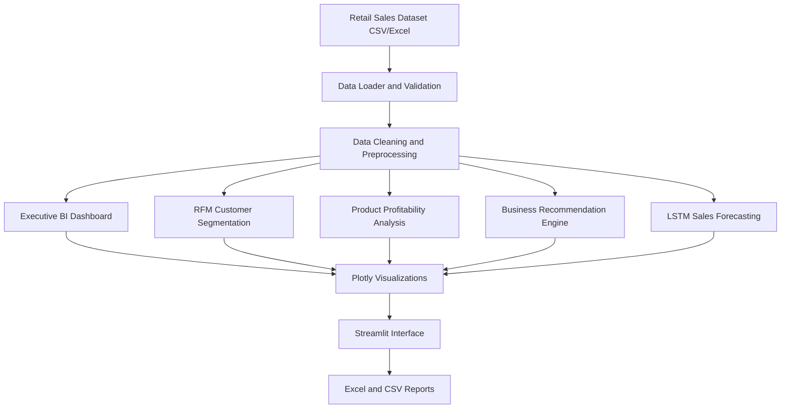

# ⚡ InsightAI – Business Intelligence & Predictive Analytics Platform

[](https://www.python.org/)
[](https://streamlit.io/)
[](https://tensorflow.org/)
[](https://scikit-learn.org/)
[](https://plotly.com/)
[](https://www.docker.com/)

**InsightAI** is a Python-based Business Intelligence and Predictive Analytics application designed to help users explore retail sales data, understand customer purchasing behaviour, analyze product profitability, and forecast future sales.

The application combines data processing, interactive dashboards, machine learning, and deep learning techniques through a Streamlit interface.

---

## 🎯 Project Overview

Traditional spreadsheet-based reporting can make it difficult to identify sales trends, understand customer behaviour, and estimate future demand.

InsightAI brings these analytical capabilities together in one application.

It covers four areas of analytics:

- **Descriptive Analytics:** Interactive dashboards displaying sales, profit, customer, and order-related metrics.
- **Diagnostic Analytics:** Analysis of sales performance, product profitability, discount patterns, and regional trends.
- **Predictive Analytics:** LSTM-based time-series forecasting to estimate future retail sales.
- **Prescriptive Analytics:** RFM-based customer segmentation and rule-based recommendations to support business decisions.

---

## 🏗️ System Architecture



---

## 🌟 Key Features

### 1. 📊 Executive BI Dashboard

- Interactive filters for date ranges, regions, and product categories.
- Displays important business metrics such as total sales, net profit, profit margin, order volume, unique customers, and average order value.
- Visualizes monthly sales trends, category-wise revenue, regional performance, and discount patterns using Plotly charts.

### 2. 👥 Customer RFM & KMeans Segmentation

- Calculates Recency, Frequency, and Monetary (RFM) values to understand customer purchasing behaviour.
- Uses Scikit-Learn KMeans clustering to group customers based on their RFM characteristics.
- Applies StandardScaler for feature scaling.
- Uses Silhouette Score to evaluate clustering quality.
- Displays customer segments through interactive 2D and 3D visualizations.

### 3. 📦 Product & Profitability Analysis

- Analyzes product-wise sales and profitability.
- Applies the Pareto 80/20 principle to identify products contributing significantly to revenue.
- Highlights top-performing products and products with poor profitability.
- Examines the relationship between discounts and profit margins.

### 4. 💡 Business Recommendation Engine

- Generates rule-based business recommendations from analyzed sales data.
- Identifies potential opportunities, warnings, and business risks.
- Highlights discount-related issues, regional underperformance, and unusual demand patterns.
- Presents recommendations through structured dashboard cards.

### 5. 🤖 LSTM Sales Forecasting

- Processes daily sales data for time-series analysis.
- Uses MinMaxScaler for feature scaling.
- Creates sliding-window sequences for model training.
- Implements an LSTM neural network using TensorFlow/Keras.
- Uses Dropout regularization and the Adam optimizer.
- Evaluates forecasting performance using MAE, RMSE, and MAPE.
- Supports 30, 60, and 90-day sales forecasting.

### 6. 📄 Reports & Excel Export

- Generates downloadable business reports in Excel and CSV formats.
- Creates multi-sheet Excel workbooks containing:
  - Executive Summary
  - Sales Dataset
  - Category Performance
  - Customer Clusters
- Uses OpenPyXL to format Excel reports with styled headers and adjusted column widths.

---

## 🛠️ Technologies Used

| Technology | Purpose |
|---|---|
| Python | Core programming language |
| Streamlit | Interactive web application |
| Pandas | Data manipulation and analysis |
| NumPy | Numerical operations |
| Scikit-Learn | KMeans clustering and data preprocessing |
| TensorFlow / Keras | LSTM-based sales forecasting |
| Plotly | Interactive data visualizations |
| OpenPyXL | Excel report generation |
| Docker | Application containerization |

---

## 📁 Repository Directory Structure

```text
InsightAI/
├── .streamlit/
│   └── config.toml
├── assets/
│   └── style.css
├── data/
│   └── sample_sales_data.csv
├── models/
│   ├── __init__.py
│   └── lstm_forecaster.py
├── saved_models/
│   └── .gitkeep
├── utils/
│   ├── __init__.py
│   ├── logger.py
│   ├── data_loader.py
│   ├── data_cleaner.py
│   ├── eda.py
│   ├── customer_analytics.py
│   ├── product_analytics.py
│   ├── ai_insights.py
│   └── reporting.py
├── charts/
│   ├── __init__.py
│   └── plotly_charts.py
├── pages/
│   ├── 1_🏠_Home.py
│   ├── 2_📂_Upload_Dataset.py
│   ├── 3_🧹_Data_Cleaning.py
│   ├── 4_📊_Dashboard.py
│   ├── 5_👥_Customer_Analytics.py
│   ├── 6_📦_Product_Analytics.py
│   ├── 7_💡_AI_Business_Insights.py
│   ├── 8_📈_LSTM_Sales_Forecasting.py
│   └── 9_📄_Reports.py
├── scratch/
│   └── test_suite.py
├── app.py
├── Dockerfile
├── docker-compose.yml
├── requirements.txt
├── .gitignore
└── README.md
```

---

## ⚡ Installation & Setup

### Option A: Local Python Environment

**1. Clone the repository**

```bash
git clone https://github.com/rakshanayak00/InsightAI.git
cd InsightAI
```

**2. Create a virtual environment**

```bash
python -m venv venv
```

**3. Activate the virtual environment**

Windows:

```bash
venv\Scripts\activate
```

macOS/Linux:

```bash
source venv/bin/activate
```

**4. Install dependencies**

```bash
pip install -r requirements.txt
```

**5. Run the application**

```bash
streamlit run app.py
```

Open the application at:

`http://localhost:8501`

### Option B: Docker

If Docker and Docker Compose are installed:

```bash
docker-compose up --build
```

Open the application at:

`http://localhost:8501`

---

## 🧪 Running Tests

The repository includes an integration test script for checking application components such as data generation, data cleaning, customer clustering, business insights, and LSTM training.

Run the test script using:

```bash
python scratch/test_suite.py
```

---

## 💡 Project Highlights

- Developed a modular Python application for retail Business Intelligence and Predictive Analytics.
- Implemented customer segmentation using RFM analysis and KMeans clustering.
- Built an LSTM-based time-series forecasting pipeline for estimating future sales.
- Created interactive dashboards and visualizations using Streamlit and Plotly.
- Developed a rule-based recommendation engine to identify business opportunities and potential risks.
- Added Excel and CSV report generation for exporting analytical results.
- Organized the application into separate modules for data processing, analytics, visualization, and reporting.

---

## 👩‍💻 Author

**Raksha Nayak**

- GitHub: [rakshanayak00](https://github.com/rakshanayak00)
- LinkedIn: [Raksha Nayak](https://www.linkedin.com/in/raksha-nayak-582856293)
